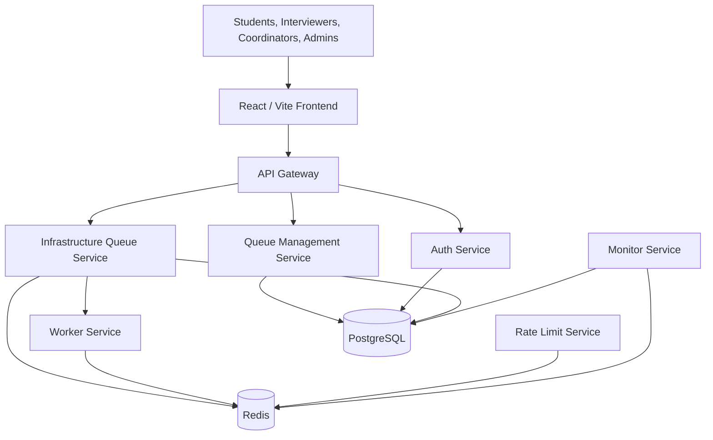
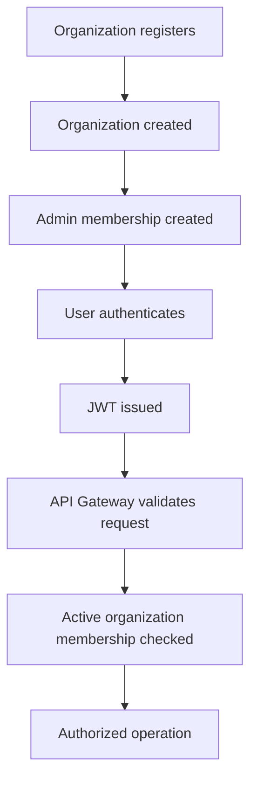
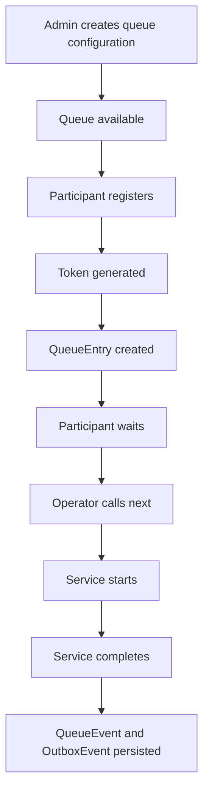
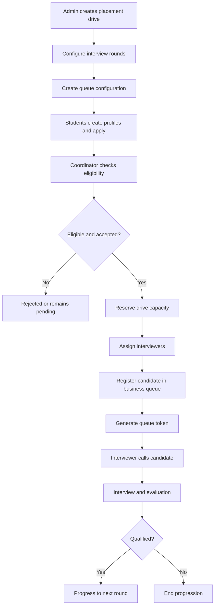
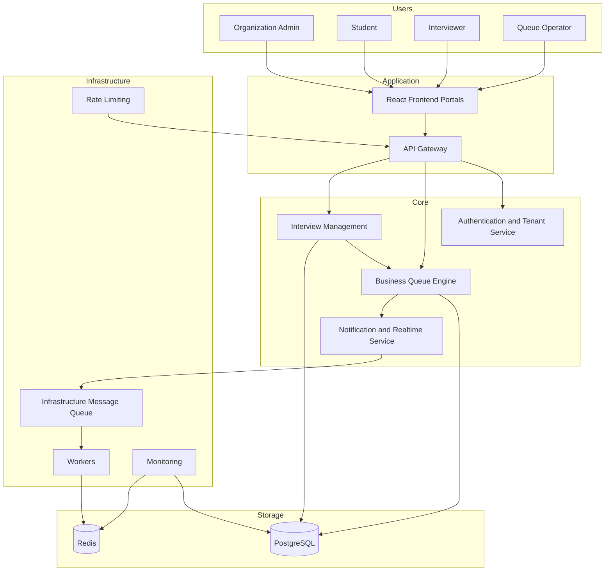

# QueueGuard — Project Blueprint, System Architecture, Workflow and Phase Progress

**Project title:** QueueGuard: An Intelligent and Fault-Tolerant Distributed Queue Management System with Concurrency Control and Adaptive Rate Limiting

> **Status note:** This document consolidates implementation history and test results reported in project discussions. It is not an independent source-code audit. Implemented does not automatically mean production-ready or deployed.

## 1. Product Blueprint

QueueGuard is a reusable, multi-application queue management platform. Its first business application is a **Student Interview Management Platform**.

The platform is intended to support queue creation and management, participant registration and token generation, operator assignment, controlled queue processing, FIFO and priority processing, tenant isolation, safe concurrent operations, monitoring, and reuse across different business workflows.

The first application manages placement drives, interview rounds, student profiles and applications, eligibility, interviewer assignments, interview queues, candidate evaluations, and progression between rounds.

### Two distinct queue concepts

| Component | Responsibility |
|---|---|
| Infrastructure Message Queue | Asynchronous system communication and background processing |
| Business Queue Engine | Real-world participant queues, tokens, operators and queue states |

A student waiting for an interview is represented by a business `QueueEntry`, not an infrastructure messaging `Message`.

## 2. System Architecture



This is a logical/target view; it does not assert that every connection is already implemented and production-verified.

### Backend services

| Service | Port | Responsibility |
|---|---:|---|
| `api-gateway` | 8080 | Request routing and gateway security |
| `auth-service` | 8081 | Authentication and identity |
| `queue-service` | 8082 | Infrastructure messaging queue |
| `worker-service` | 8083 | Asynchronous background processing |
| `rate-limit-service` | 8084 | Request rate limiting |
| `monitor-service` | 8085 | System monitoring |
| `queue-management-service` | As configured | Business queue and interview domain |
| `common` | — | Shared libraries and components |

QMS owns the business queue domain and `qms_db`.

### Data and security

| Technology | Purpose |
|---|---|
| PostgreSQL 15+ | Authoritative relational persistence |
| Redis | Queue infrastructure and fast supporting operations |
| Flyway | Database migrations |
| Spring Data JPA / Hibernate | Persistence |
| Transactional outbox | Reliable event recording alongside business changes |

Controls include JWT validation, tenant isolation, role-based authorization, active-membership checks, database constraints, optimistic and pessimistic locking, `SELECT FOR UPDATE SKIP LOCKED`, transactional outbox, rate limiting and controlled state transitions.

A valid JWT alone is not sufficient: the user must have active membership in the organization being accessed.

## 3. Workspace Overview

The backend is a Maven multi-module project. This is a logical representation, not a verified exact file inventory.

```text
queueguard/
├── pom.xml
├── docker-compose.yml
├── services/
│   ├── api-gateway/
│   ├── auth-service/
│   ├── queue-service/
│   ├── worker-service/
│   ├── rate-limit-service/
│   ├── monitor-service/
│   └── queue-management-service/
│       ├── src/main/java/
│       │   ├── controller/
│       │   ├── service/
│       │   ├── repository/
│       │   ├── entity/
│       │   ├── dto/
│       │   └── security/
│       ├── src/main/resources/db/migration/
│       └── src/test/
├── common/
├── infrastructure/
│   ├── docker/
│   └── kubernetes/
├── scripts/
└── docs/
    ├── CURRENT_ARCHITECTURE.md
    ├── TARGET_ARCHITECTURE.md
    ├── DATABASE_DESIGN.md
    ├── API_DESIGN.md
    ├── IMPLEMENTATION_ROADMAP.md
    └── ARCHITECTURAL_DECISIONS.md
```

The listed architecture documents were created during planning. Check the actual repository before treating this as an exact directory listing.

### Business Queue Engine entities

| Entity | Responsibility |
|---|---|
| `QueueConfiguration` | Queue rules and capacity |
| `QueueEntry` | Participant's queue record |
| `QueueAssignment` | Operator assignment |
| `QueueEvent` | Queue lifecycle event |
| `OutboxEvent` | Reliable downstream event record |

Queue lifecycle:

```text
WAITING → CALLED → IN_SERVICE → COMPLETED
```

Other states/transitions include `CANCELLED`, `NO_SHOW`, `SKIPPED`, and requeue to `WAITING`. Ordering supports `FIFO` and `PRIORITY_FIFO`.

### Interview domain entities

| Entity | Responsibility |
|---|---|
| `PlacementDrive` | Organization's placement drive |
| `CandidateProfile` | Organization-scoped student profile |
| `CandidateApplication` | Application to a drive |
| `InterviewRound` | Round linked to a drive and queue configuration |
| `CandidateRound` | Candidate's participation and outcome |
| `InterviewerAssignment` | Interviewer assignment |
| `Evaluation` | Interview assessment |

**Ownership rule:** `QueueEntry` owns queue status. `CandidateRound` must not duplicate it.

## 4. End-to-End Workflows

### Organization onboarding



Tenant identity and membership determine which organization's data the user can access.

### Generic business queue



### Student interview workflow



### Interview business rules

1. An application must be `ELIGIBLE` before acceptance.
2. Application states include `SUBMITTED`, `ACCEPTED`, `REJECTED` and `WITHDRAWN`.
3. Rejected and withdrawn applications are terminal.
4. Accepted withdrawal retains the capacity reservation.
5. Drive capacity is protected by locking the drive row.
6. Queue configuration must exist before creating an interview round.
7. Evaluations use scores from 0–100 and are immutable.
8. Application numbers use a database-backed counter, not `MAX(id) + 1`.

## 5. Phase-by-Phase Status

| Phase | Scope | Status |
|---|---|---|
| Phase 0 | Foundation, testing, CI and OpenAPI | Completed |
| Phase 1 | Identity and multi-tenancy | Implemented |
| Phase 2 | Generic Business Queue Engine | Implemented and concurrency-tested |
| Phase 3 | Student Interview Management | Core through Phase 3.3; next subphase pending |
| Phase 4 | Notifications and real-time updates | Planned |
| Phase 5 | React frontend and portals | Planned |
| Phase 6 | Minikube/Kubernetes deployment | Partially prepared |
| Phase 7 | Scaling, resilience and performance | Planned |

### Phase 0 — Foundation

**Completed.** Work included `.gitignore`, Maven multi-module setup, root build configuration, GitHub Actions CI, test dependencies, Springdoc Swagger UI, security tests and Redis queue tests. Initial verification reported a successful build with seven tests passing.

### Phase 1 — Identity and multi-tenancy

**Implemented.** Work included QMS, dedicated `qms_db`, Flyway migrations for organizations and memberships, membership/role management, JWT validation in QMS, tenant-aware authorization, gateway routing, Docker Compose updates, Kubernetes configuration and scripts, and OpenAPI support. An earlier build reported 13 tests passing.

### Phase 2 — Generic Business Queue Engine

**Implemented and subsequently hardened.** The original implementation reported 18 tasks, five core entities, queue state machine, token generator, queue configuration CRUD, participant registration, operator workflow and 21 REST endpoints under:

```text
/api/v1/organizations/{orgId}/queues/*
```

Persistence included Flyway V2, five tables, indexes, constraints and transactional outbox. Concurrency included `SELECT FOR UPDATE SKIP LOCKED`, optimistic locking with `@Version`, tenant isolation and capacity protection.

The initial verification reported 47 passed and 7 skipped; some PostgreSQL concurrency verification was pending at that point.

The Docker/Testcontainers compatibility issue was later resolved by upgrading to Testcontainers 1.21.4 and Docker Java 3.4.2.

The subsequent audit strengthened PostgreSQL tests and fixed two production races:
1. FIFO and priority queries select one row using `LIMIT 1 FOR UPDATE SKIP LOCKED`.
2. `callNext()` locks the queue configuration to avoid acting on stale OPEN status during a concurrent pause.

**Latest reported verification:**

| Test suite | Passed | Failed | Skipped |
|---|---:|---:|---:|
| PostgreSQL persistence | 10 | 0 | 0 |
| Queue concurrency integration | 9 | 0 | 0 |
| Full Maven verification | 83 | 0 | 0 |

The full build reported `BUILD SUCCESS`: 80 QMS tests and 3 common-module tests. Concurrency tests used independent PostgreSQL sessions within one application process; they do not prove multi-node behaviour.

### Phase 3 — Student Interview Management

**Core implementation and database/concurrency hardening completed; next subphase remains.**

#### Phase 3.1 — Domain model and schema

Reported completed: seven domain entities, eight enums, V3 migration, V4 eligibility constraint and V5 application number counter. Constraints include organization-scoped profile ownership, composite foreign keys, one-to-one candidate-round/queue-entry relationship, same-drive/same-queue consistency and capacity reservations.

#### Phase 3.2 — Repositories and allocation

Reported completed: repository layer, database-backed application number allocator, persistence relationships and constraints.

#### Phase 3.3 — Business services

Reported completed:
- `PlacementDriveService`
- `CandidateProfileService`
- `CandidateApplicationService`
- `InterviewRoundService`
- `InterviewerAssignmentService`
- `Phase3Access`

The subsequent audit addressed business lifecycle and transaction concerns.

**Current reported verification:** QMS migrations V1–V5 validated and applied; Hibernate schema validation passed; persistence and queue concurrency tests passed; full Maven build passed with 83 tests and no failures or skips; no migration changes were needed during the latest concurrency hardening.

**Remaining:** Phase 3.4 and subsequent application/API integration work need to be defined and completed. The complete student/interviewer frontend journey and all end-to-end interview workflows are not verified as finished.

### Phase 4 — Notifications and real-time updates

**Planned.** Expected work: queue status notifications, candidate interview notifications, interviewer assignment notifications, email, real-time queue updates, WebSocket integration, outbox event consumption, retries and failure handling. The outbox groundwork exists, but the complete notification system is not implemented.

### Phase 5 — React frontend and portals

**Planned.** Expected work: authentication, organization dashboard, admin portal, student portal, interviewer portal, queue operator dashboard, live queue status, interview evaluation screens and monitoring dashboard.

### Phase 6 — Minikube and Kubernetes

**Partially prepared.** Kubernetes configuration/deployment scripts, Minikube-related build/deployment workflow and Docker Compose environment were prepared.

Still required:
- Deploy the complete application.
- Configure service communication, database and Redis.
- Configure secrets and environment.
- Set up ingress and external access.
- Configure persistent storage.
- Add health/readiness probes.
- Run end-to-end tests inside the cluster.

Deployment scripts do not equal a fully deployed and verified application.

### Phase 7 — Scaling, resilience and performance

**Planned.** Expected work: load testing, realistic concurrent registration, rate-limit validation, horizontal and worker scaling, failure recovery, circuit breakers/retries, connection-pool tuning, throughput/latency measurement and monitoring dashboards.

## 6. Remaining Technical Issues

| Item | Current status |
|---|---|
| Call-next idempotency | Contract question: request carries an idempotency key, but `callNext()` does not currently use it |
| Multi-node concurrency | Not verified across multiple service instances |
| Kubernetes runtime | Full deployment and integration not verified |
| Real-time notifications | Planned |
| Frontend end-to-end workflow | Not verified as complete |
| Production load testing | Planned |
| Monitoring under realistic load | Planned |

### Call-next idempotency decision

If a client retries `callNext` after a timeout, decide whether the retry returns the original assignment or claims another participant. This needs an explicit design decision and tests.

## 7. Overall Completion Summary

```text
QUEUEGUARD PROJECT PROGRESS
===========================

FOUNDATION
  Phase 0  [##########] 100%  Completed

IDENTITY & TENANCY
  Phase 1  [##########] 100%  Implemented

BUSINESS QUEUE ENGINE
  Phase 2  [##########] 100%  Implemented and hardened

INTERVIEW MANAGEMENT
  Phase 3  [########--] Core services and hardening done
                               Phase 3.4 onward pending

APPLICATION EXPERIENCE
  Phase 4  [----------] Planned
  Phase 5  [----------] Planned

DEPLOYMENT
  Phase 6  [##--------] Partially prepared

PRODUCTION READINESS
  Phase 7  [----------] Planned
```

**Current milestone:** QueueGuard Backend Foundation + Generic Business Queue Engine + Interview Management Core — completed through Phase 3.3 and its concurrency hardening.

This does not mean QueueGuard is production-ready or that the full application is complete.

Practical summary:
- Three major phases completed: 0, 1 and 2.
- Phase 3 core implementation completed through Phase 3.3.
- PostgreSQL persistence and concurrency hardening reported verified.
- Phase 6 deployment preparation partially exists.
- Phases 4, 5 and 7 remain planned.

The available project history confirms Phases 0–7. Earlier planning references mention a longer roadmap, but verified names and scope for Phases 8–10 are not available here and are not invented in this document.

## 8. Recommended Next Development Sequence

| Priority | Next work | Reason |
|---:|---|---|
| 1 | Close Phase 3.4 | Finish and verify interview management backend |
| 2 | Resolve call-next idempotency | Close outstanding API contract question |
| 3 | Complete Phase 4 | Add notifications and real-time updates |
| 4 | Complete Phase 5 | Build student, interviewer and admin portals |
| 5 | Complete Phase 6 | Deploy the complete application in Minikube |
| 6 | Complete Phase 7 | Load, resilience and scaling verification |

Finish backend workflows and notification contracts before building UI around APIs that may still change.

## 9. Final Target Architecture



This is the target vision, not a statement that all components are already implemented.

## 10. Project Management Principle

Do not start a new phase just because the previous phase compiles. Start the next phase only when:
1. Functional acceptance criteria are satisfied.
2. Automated tests pass.
3. Database migrations are verified.
4. Security and tenant-isolation checks pass.
5. Integration behaviour is verified.
6. Known limitations are documented.

**Current recommended milestone:** Finish Phase 3.4, resolve the call-next idempotency contract, and then proceed to notifications and the frontend.

---

*Document status: Consolidated project blueprint based on reported implementation history and test results. Update phase statuses as new work is implemented and independently verified.*
