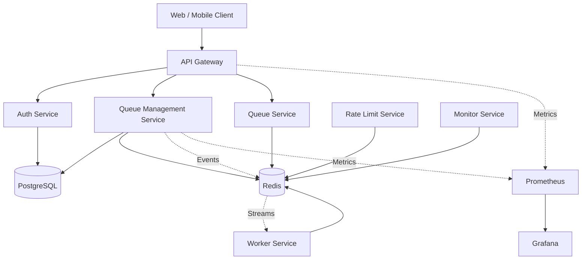
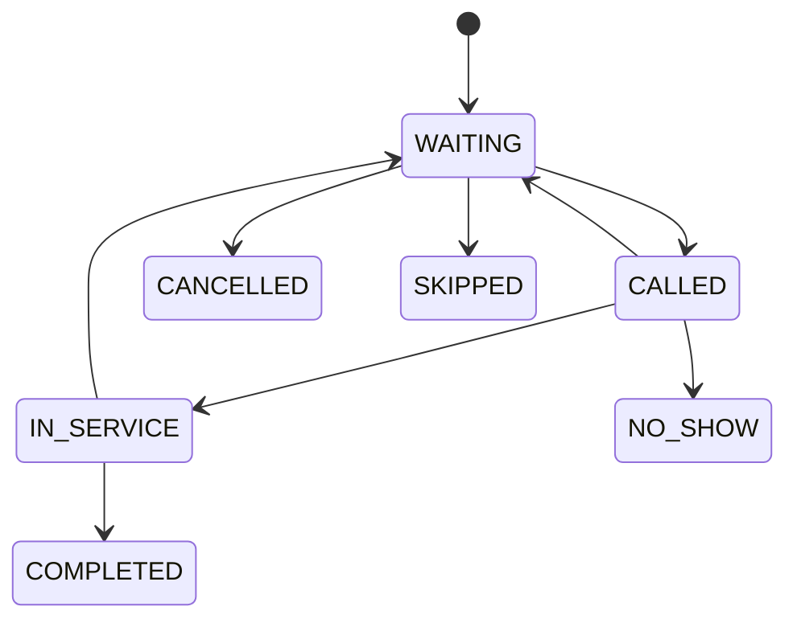
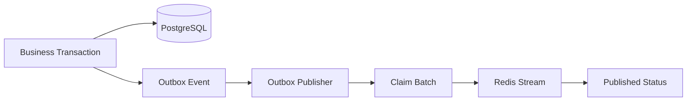
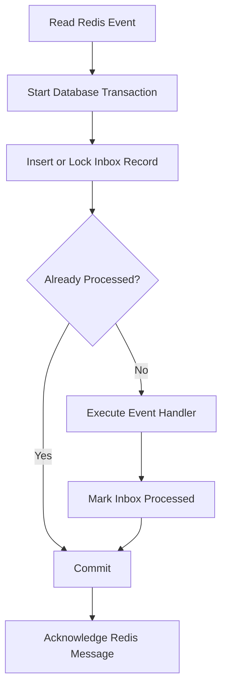
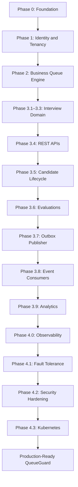

# QueueGuard — Complete Implementation Roadmap

**Project:** QueueGuard  
**Architecture:** Distributed Microservices  
**Primary Stack:** Java 17, Spring Boot 3.2.5, PostgreSQL, Redis, Docker, Kubernetes  
**Development Strategy:** Incremental, test-driven, phase-based implementation  
**Current Development Phase:** Phase 3.8 — Event Consumers and Idempotent Processing  
**Current Branch:** `feature/phase3.8`  
**Latest Commit:** `2880fb7`

---

# 1. Project Vision

## 1.1 What is QueueGuard?

QueueGuard is a distributed, multi-tenant queue management and interview coordination platform.

It is designed to manage the complete lifecycle of an organization's queue-based operations, from participant registration and token allocation to operator workflows, interview scheduling, evaluation, and analytics.

The platform aims to provide:

- Reliable queue management.
- Fair and configurable participant ordering.
- Real-time queue processing.
- Multi-tenant organizational isolation.
- Structured interview and evaluation workflows.
- Reliable asynchronous event processing.
- Operational visibility and analytics.
- Scalable deployment through container orchestration.

QueueGuard is not intended to be just a token-generation application. It is being developed as a distributed backend system that demonstrates practical engineering concepts such as concurrency control, transactional consistency, event-driven architecture, fault tolerance, and observability.

## 1.2 Core Engineering Principles

| Principle | Implementation |
|---|---|
| Database authority | PostgreSQL is the source of truth. |
| Tenant isolation | Organization-scoped authorization and data access. |
| Service ownership | Each microservice owns its business data. |
| Reliable messaging | Transactional outbox and inbox patterns. |
| Idempotency | Duplicate event processing protection. |
| Concurrency safety | Database locking, optimistic locking, and atomic operations. |
| Scalability | Stateless services and distributed infrastructure. |
| Security | JWT authentication and membership-based authorization. |
| Observability | Metrics, logs, tracing, and health monitoring. |
| Deployment | Docker Compose and Kubernetes. |

---

# 2. System Architecture

## 2.1 High-Level Architecture



*Conceptual architecture showing the major service and infrastructure boundaries. Exact deployment topology can evolve as later phases are implemented.*

## 2.2 Microservice Responsibilities

| Component | Responsibility |
|---|---|
| API Gateway | Entry point, routing, and request-level security. |
| Auth Service | User registration, authentication, and JWT issuance. |
| Queue Management Service (QMS) | Business queues, candidate rounds, evaluations, and queue workflows. |
| Queue Service | Infrastructure-level message and queue operations. |
| Worker Service | Asynchronous background processing. |
| Rate Limit Service | Request throttling and distributed rate limiting. |
| Monitor Service | System monitoring and operational health. |
| PostgreSQL | Persistent business data and transactional consistency. |
| Redis | Streams, distributed coordination, caching, and ephemeral state. |

**Important architectural boundary:** QMS owns business queue and interview workflows. Queue Service owns infrastructure-level messaging. These responsibilities must not be mixed.

---

# 3. Development Progress and Phase Status

| Phase | Name | Status |
|---|---|---|
| Phase 0 | Project Foundation | ✅ Completed |
| Phase 1 | Identity and Multi-Tenancy | ✅ Completed |
| Phase 2 | Business Queue Engine | ✅ Completed |
| Phase 3.1 | Interview Domain Foundation | ✅ Completed |
| Phase 3.2 | Interview Domain Persistence | ✅ Completed |
| Phase 3.3 | Interview Business Services | ✅ Completed |
| Phase 3.4 | Interview REST APIs | ✅ Completed |
| Phase 3.5 | Candidate Round Lifecycle | ✅ Completed |
| Phase 3.6 | Interview Evaluations | ✅ Completed |
| Phase 3.7 | Transactional Outbox Publisher | ✅ Completed |
| Phase 3.8 | Event Consumers and Idempotent Processing | 🟡 Implemented, committed, pushed; PR/CI/merge pending |
| Phase 3.9 | Placement and Interview Analytics | ⏳ Upcoming |
| Phase 4.0 | Observability and Monitoring | ⏳ Planned |
| Phase 4.1 | Distributed Rate Limiting and Fault Tolerance | ⏳ Planned |
| Phase 4.2 | Security Hardening | ⏳ Planned |
| Phase 4.3 | Kubernetes Deployment and Production Readiness | ⏳ Planned |

**Status definitions:**

- Completed: Implementation and verification reported complete.
- Implemented: Code is committed and pushed, but integration into the main branch is pending.
- Upcoming: Next planned implementation phase.
- Planned: Roadmap work not yet started.

---

# 4. Phase-by-Phase Implementation Roadmap

# PHASE 0 — Project Foundation

**Objective:** Establish the project structure, development environment, and foundational engineering infrastructure.

### Implementation

- Create the Maven multi-module project.
- Configure Java 17.
- Integrate Spring Boot 3.2.5.
- Establish common dependency management.
- Configure service modules.
- Add Docker Compose infrastructure.
- Configure PostgreSQL and Redis.
- Establish CI workflows.
- Add API documentation support through Springdoc.
- Introduce foundational security and integration tests.

### Core technologies

- Java 17
- Spring Boot
- Maven
- PostgreSQL
- Redis
- Docker Compose
- GitHub Actions
- Springdoc OpenAPI

### Completion criteria

- All modules build successfully.
- Services start with the expected configuration.
- CI builds the project.
- Foundational integration tests pass.

**Status: COMPLETED**

---

# PHASE 1 — Identity and Multi-Tenancy

**Objective:** Establish authentication, organization identity, and tenant isolation.

### Implementation

1. Implement user registration and authentication.
2. Generate and validate JWT access tokens.
3. Introduce organizations and memberships.
4. Implement membership status verification.
5. Establish organization-scoped authorization.
6. Integrate authentication with API Gateway.
7. Establish QMS database ownership.
8. Add the initial Flyway migration.
9. Configure Docker Compose and Kubernetes service settings.

### Core domain concepts

- User
- Organization
- Organization Membership
- Role
- JWT
- Tenant Context

### Security requirements

- Unauthenticated requests must be rejected.
- Inactive memberships must not grant access.
- Users must not access another organization's resources.
- Authorization must be enforced at the service boundary.

### Completion criteria

- Authentication works.
- JWT validation works.
- Organization membership is enforced.
- Tenant isolation tests pass.

**Status: COMPLETED**

---

# PHASE 2 — Business Queue Engine

**Objective:** Build the core queue management engine with concurrency-safe operations.

This is the foundation of QueueGuard's business workflow.

### 2.1 Queue Configuration

Implement:

- Queue creation.
- Queue retrieval.
- Queue configuration updates.
- Queue activation and deactivation.
- Queue capacity management.
- Queue operating modes.

Supported ordering strategies:

- FIFO — First In, First Out.
- PRIORITY_FIFO — Priority-based ordering with FIFO ordering within a priority level.

### 2.2 Queue Entry Lifecycle

Implement the following states:



The `QueueEntry` is the authoritative owner of queue status.

### 2.3 Queue Operations

Implement:

- Participant registration.
- Token allocation.
- Next participant selection.
- Participant calling.
- Service start.
- Service completion.
- Cancellation.
- No-show handling.
- Skip operations.
- Requeue operations.
- Queue pause and resume.

### 2.4 Concurrency and Consistency

Implement:

- PostgreSQL `SELECT FOR UPDATE SKIP LOCKED`.
- Optimistic locking through `@Version`.
- Atomic token allocation.
- Capacity locking.
- Partial unique indexes.
- Transactional outbox.
- Database constraints.
- Tenant isolation at the query and authorization layers.

### 2.5 Testing

Test:

- Concurrent token generation.
- Concurrent capacity allocation.
- Concurrent call-next operations.
- FIFO ordering.
- Priority FIFO ordering.
- Pause/call race conditions.
- Optimistic locking.
- Transaction rollback.
- Outbox consistency.
- Tenant isolation.

### Completion criteria

- No duplicate active token allocation.
- Queue capacity cannot be exceeded through concurrent registration.
- Queue state transitions remain valid.
- Concurrent operations preserve database consistency.

**Status: COMPLETED**

---

# PHASE 3 — Interview and Placement Management

**Objective:** Extend the queue engine into a complete candidate interview and evaluation workflow.

This phase transforms QueueGuard from a queue management engine into an interview coordination platform.

## PHASE 3.1–3.3 — Interview Domain and Business Services

### Objective

Establish the interview domain model, persistence layer, and core business services.

### Domain components

- Drive
- Round
- Candidate
- Candidate Profile
- Candidate Round
- Interview Assignment
- Evaluation

### Implementation

- Create interview-related entities.
- Define relationships and ownership.
- Add Flyway migrations.
- Create repositories.
- Implement application number allocation.
- Implement domain services.
- Integrate with the existing QMS queue engine.

### Architectural requirement

Candidate interview progression must remain separate from queue status ownership.

`CandidateRound` references `QueueEntry`; it does not independently own or duplicate queue status.

**Status: COMPLETED**

## PHASE 3.4 — Interview REST APIs

### Objective

Expose interview domain operations through secured REST endpoints.

### Implementation

- REST controllers.
- Request and response DTOs.
- Input validation.
- Exception handling.
- Authorization checks.
- OpenAPI documentation.
- JWT bearer authentication in Swagger UI.

### Completion criteria

- API requests are validated.
- Unauthorized operations are rejected.
- Organization boundaries are enforced.
- API contracts are documented.

**Status: COMPLETED**

## PHASE 3.5 — Candidate Round Lifecycle

### Objective

Implement the complete candidate progression workflow across interview rounds.

### Implementation

- Candidate registration.
- Candidate round creation.
- Candidate round retrieval.
- Candidate decisions.
- Candidate progression.
- Round completion.
- Sequential progression validation.
- Integration with QueueEntry.
- Authorization before locking.
- Consistent database lock ordering.

### Important business rule

A candidate must not bypass the required sequential qualification process.

Candidate progression must respect the preceding round's decision and the drive's lifecycle.

### Testing

- Registration validation.
- Round progression.
- Invalid progression rejection.
- Authorization.
- Concurrency.
- Tenant isolation.
- Transaction rollback.

**Status: COMPLETED**

## PHASE 3.6 — Interview Evaluations

### Objective

Implement a reliable evaluation system for interview assignments.

### API endpoints

```http
POST /candidate-rounds/{candidateRoundId}/evaluations

GET /candidate-rounds/{candidateRoundId}/evaluations

GET /evaluations/me
```

### Implementation

- Evaluation submission.
- Evaluation retrieval.
- Assignment-based authorization.
- Immutable evaluation records.
- Transactional evaluation persistence.
- `EVALUATION_SUBMITTED` outbox event.
- Database migration V6.

### Business rules

- Only authorized interview assignments can submit evaluations.
- Submitted evaluations must remain immutable.
- Evaluation persistence and outbox event creation must happen in the same database transaction.

**Status: COMPLETED**

## PHASE 3.7 — Transactional Outbox Publisher

### Objective

Reliably publish database events to Redis Streams without losing events between database commits and message publication.

### Architecture



### Implementation

- Outbox event persistence.
- PostgreSQL batch claiming.
- `FOR UPDATE SKIP LOCKED`.
- Redis Streams publishing.
- Stable event identifiers.
- Retry scheduling.
- Exponential backoff.
- Maximum retry attempts.
- Failed event handling.
- Stale claim recovery.
- Claim-token validation.
- Per-aggregate ordering.
- Redis persistence configuration.

### Event contract

The published stream uses:

- `eventId`
- `eventType`
- `organizationId`
- `aggregateType`
- `aggregateId`
- `payload`
- `createdAt`
- Optional `idempotencyKey`

Existing publisher field names and serialization must remain compatible with consumers.

**Status: COMPLETED**

## PHASE 3.8 — Event Consumers and Idempotent Processing

**Objective:** Build reliable Redis Streams consumers that can process events safely despite duplicate delivery, failures, and service restarts.

### 3.8.1 Redis Consumer Groups

Implement:

- Redis consumer group creation.
- Stable consumer group names.
- Unique process-level consumer identities.
- Stream polling.
- Message acknowledgment.
- Consumer group recovery.

### 3.8.2 Inbox Pattern

Introduce an inbox persistence model.

The inbox provides:

- Consumer identity.
- Event identity.
- Organization identity.
- Processing status.
- Attempt tracking.
- Failure information.

Use a unique constraint on:

```sql
UNIQUE (consumer_name, event_id)
```

This prevents the same consumer from applying the same event more than once.

### 3.8.3 Transactional Processing

The intended processing lifecycle:



The database transaction commits before the Redis acknowledgment.

### 3.8.4 Failure Recovery

Implement:

- Pending-message recovery.
- Minimum idle time.
- Redis `XCLAIM`.
- Transient retry handling.
- Permanent failure classification.
- Dead-letter publishing.
- Retry limits.
- Deleted pending-entry tombstones.
- Safe acknowledgment after durable dead-letter handling.
- Graceful shutdown.

### 3.8.5 Delivery Semantics

The design provides:

**At-least-once message delivery with transactional inbox deduplication for effectively-once database processing.**

It does not guarantee exactly-once Redis delivery.

### Current implementation limitations

- Current handler is inbox-only.
- No downstream business mutations yet.
- No DLQ replay API.
- No operational consumer metrics.
- Bounded pending scans may delay recovery under heavy pending loads.
- If a source entry has been deleted, its original payload cannot be recovered; the tombstone preserves failure metadata.

### Verification

Reported verification:

- 17 focused consumer tests passed.
- Full clean Maven verification: 155 tests passed.
- Zero reported failures, errors, or skipped tests.
- PostgreSQL 15.20 and Redis 7 Testcontainers used for integration tests.

### Completion criteria

- Duplicate event delivery does not duplicate database effects.
- Failed processing is recoverable.
- Messages are not acknowledged before durable processing or dead-letter handling.
- Consumer group loss can be recovered.
- Shutdown does not silently acknowledge unfinished work.

**Status: IMPLEMENTED, COMMITTED AND PUSHED**

Commit:

```text
2880fb7 feat(qms): complete event consumers and idempotent processing
```

Branch:

```text
feature/phase3.8
```

**Remaining integration work:** Create/review the pull request, verify GitHub Actions, and merge into `main`.

---

# PHASE 3.9 — Placement and Interview Analytics

**Objective:** Turn QueueGuard's accumulated business data into meaningful operational insights.

This phase should build analytics on top of the existing queue, candidate, round, assignment, and evaluation domains.

### 3.9.1 Queue Analytics

Implement metrics such as:

- Total registrations.
- Current waiting count.
- Completed service count.
- Cancellation count.
- No-show count.
- Average waiting time.
- Average service duration.
- Queue throughput.
- Peak queue load.
- Queue utilization.

### 3.9.2 Interview Analytics

Implement:

- Total registered candidates.
- Candidates currently in each round.
- Candidates who passed.
- Candidates who failed.
- Candidates who withdrew.
- Round-wise success rates.
- Interview completion rates.
- Average time spent in each round.
- Candidate progression funnel.

### 3.9.3 Placement Analytics

Implement:

- Total candidates eligible for placement.
- Candidates selected.
- Candidates rejected.
- Offer statistics.
- Placement conversion rate.
- Organization-wise placement trends.
- Drive-wise placement statistics.

Placement-related metrics must reflect the actual available domain data. If offers and joining outcomes are not yet modeled, introduce those domain concepts explicitly rather than inferring them from interview decisions.

### 3.9.4 Interviewer Analytics

Implement:

- Interview assignments per interviewer.
- Evaluations submitted.
- Pending evaluations.
- Average evaluation turnaround time.
- Interview workload distribution.
- Round-wise interviewer activity.

### 3.9.5 Analytics API

Potential endpoint structure:

```http
GET /analytics/queues
GET /analytics/queues/{queueId}

GET /analytics/drives
GET /analytics/drives/{driveId}

GET /analytics/rounds/{roundId}

GET /analytics/interviewers

GET /analytics/placement
```

These are proposed API contracts and should be finalized during implementation.

### 3.9.6 Technical Design

Implement:

- Tenant-scoped analytical queries.
- Aggregation queries.
- Date-range filters.
- Pagination where appropriate.
- Efficient indexes.
- Read-only analytics endpoints.
- Optional materialized views or summary tables when justified by measured query load.

Avoid cross-service database joins. Analytics must respect service ownership and data boundaries.

### 3.9.7 Testing

Test:

- Aggregation correctness.
- Date filtering.
- Tenant isolation.
- Empty datasets.
- Large datasets.
- Query performance.
- Consistency between source records and reported metrics.

### Completion criteria

- Analytics reflect actual persisted business data.
- Metrics are organization-scoped.
- Queries are efficient.
- Results can be consumed by a dashboard or frontend.

**Status: UPCOMING**

---

# PHASE 4 — Production Engineering and Reliability

Phase 4 focuses on making QueueGuard observable, resilient, secure, and deployable in a production-like environment.

## PHASE 4.0 — Observability and Monitoring

**Objective:** Make the internal behavior and health of the distributed system visible.

### 4.0.1 Application Metrics

Integrate:

- Spring Boot Actuator.
- Micrometer.
- Prometheus metrics.

Collect:

- HTTP request count.
- Request latency.
- Error rate.
- JVM memory usage.
- CPU utilization.
- Database connection pool usage.
- Redis operation metrics.
- Outbox publishing metrics.
- Inbox processing metrics.
- Consumer lag and pending-message metrics.

### 4.0.2 Dashboards

Integrate Grafana.

Build dashboards for:

1. API Gateway health.
2. Microservice health.
3. Queue throughput.
4. Database performance.
5. Redis performance.
6. Outbox processing.
7. Consumer processing.
8. JVM and infrastructure metrics.

### 4.0.3 Distributed Tracing

Integrate distributed tracing using OpenTelemetry-compatible instrumentation.

Track request flow across:

```text
Client
  → API Gateway
  → QMS
  → PostgreSQL / Redis
  → Background Consumer
```

### 4.0.4 Structured Logging

Implement:

- Structured JSON logs.
- Correlation IDs.
- Trace IDs.
- Consistent error fields.
- Request metadata.
- Event-processing context.

Avoid logging access tokens, passwords, or sensitive candidate information.

### Completion criteria

- Service health is observable.
- Failures can be diagnosed across service boundaries.
- Important queue and event metrics are measurable.
- Dashboards provide operational visibility.

**Status: PLANNED**

---

## PHASE 4.1 — Distributed Rate Limiting and Fault Tolerance

**Objective:** Protect the platform from overload and improve behavior during infrastructure failures.

### 4.1.1 Distributed Rate Limiting

Implement:

- Redis-backed rate limiting.
- Per-user limits.
- Per-organization limits.
- Endpoint-specific limits.
- Configurable rate-limit policies.
- Consistent HTTP 429 responses.

Potential algorithms:

- Token Bucket.
- Sliding Window.
- Fixed Window.

Choose algorithms based on the required traffic and fairness characteristics.

### 4.1.2 Fault Tolerance

Implement:

- Timeouts.
- Controlled retries.
- Circuit breakers.
- Bulkheads where appropriate.
- Graceful degradation.
- Dependency health checks.

### 4.1.3 Resilience Testing

Test:

- Redis unavailability.
- PostgreSQL connection failures.
- Slow downstream services.
- Repeated request bursts.
- Recovery after dependency restoration.
- Retry storms and cascading failures.

### Completion criteria

- Traffic spikes are controlled.
- Failures do not unnecessarily cascade across services.
- Recovery behavior is predictable.
- Rate limiting works across multiple service instances.

**Status: PLANNED**

---

## PHASE 4.2 — Security Hardening

**Objective:** Strengthen application, API, infrastructure, and data security.

### 4.2.1 Authentication and Authorization

Review:

- JWT expiration and validation.
- Role-based access control.
- Organization membership verification.
- Endpoint authorization.
- Privilege escalation risks.
- Token refresh and revocation strategy, if required.

### 4.2.2 Application Security

Implement or verify:

- Input validation.
- Secure exception responses.
- SQL injection protection.
- CORS policy.
- CSRF policy appropriate to the authentication model.
- Request size limits.
- Security headers.
- Sensitive-data handling.

### 4.2.3 Infrastructure Security

Implement:

- Secrets management.
- Database credential protection.
- Redis access restrictions.
- Network isolation.
- TLS where appropriate.
- Container image vulnerability scanning.
- Dependency vulnerability scanning.

### 4.2.4 Security Testing

Test:

- Cross-tenant access attempts.
- Unauthorized role access.
- Expired and invalid JWTs.
- Privilege escalation.
- Injection attempts.
- Sensitive information leakage.

### Completion criteria

- Authorization is consistently enforced.
- Secrets are not committed to source control.
- Sensitive data is protected.
- Security checks are part of CI.

**Status: PLANNED**

---

## PHASE 4.3 — Kubernetes Deployment and Production Readiness

**Objective:** Deploy QueueGuard as a containerized, orchestrated microservice system.

### 4.3.1 Containerization

Finalize Docker images for all services.

Implement:

- Multi-stage Docker builds.
- Smaller production images.
- Non-root containers.
- Health checks.
- Environment-based configuration.

### 4.3.2 Kubernetes Resources

Create and verify:

- Deployments.
- Services.
- ConfigMaps.
- Secrets.
- Ingress.
- Persistent storage where needed.
- Resource requests and limits.
- Liveness probes.
- Readiness probes.
- Startup probes.

### 4.3.3 Scaling

Implement:

- Multiple service replicas.
- Horizontal Pod Autoscaling.
- Resource-based scaling.
- Graceful termination.
- Safe consumer shutdown.
- Database connection pool sizing.

### 4.3.4 Infrastructure and Deployment

Establish:

- PostgreSQL deployment or managed database configuration.
- Redis deployment or managed Redis configuration.
- Persistent volumes where appropriate.
- Environment-specific configurations.
- Deployment automation.
- Rollback procedures.

### 4.3.5 Production Readiness Testing

Test:

- Pod restart recovery.
- Service-to-service communication.
- Database persistence.
- Redis persistence and recovery.
- Consumer group recovery.
- Multiple application replicas.
- Load handling.
- Rolling updates.
- Graceful shutdown.
- Failure recovery.

### Completion criteria

- All required services deploy successfully.
- Health checks work correctly.
- Services recover from pod restarts.
- Horizontal scaling does not break concurrency guarantees.
- Configuration and secrets are managed safely.

**Status: PLANNED**

---

# 5. Recommended Implementation Order

The roadmap should be followed in dependency order.



Some work can overlap after its dependencies are established, but the integration and verification gates should remain intact.

---

# 6. Engineering Workflow for Every Phase

Every implementation phase must follow the same development discipline.

## Step 1 — Inspect

Before editing:

- Inspect existing architecture.
- Review relevant source files.
- Review existing database migrations.
- Review tests.
- Identify dependencies.
- Identify backward compatibility constraints.

Do not rewrite working components without a clear requirement.

## Step 2 — Plan

Create a bounded implementation plan containing:

- Objective.
- Scope.
- Out-of-scope work.
- Files likely to change.
- Database changes.
- API changes.
- Security requirements.
- Test scenarios.
- Acceptance criteria.

## Step 3 — Implement

Use small, reviewable changes.

Preserve:

- Existing service ownership.
- Database boundaries.
- API compatibility.
- Event contracts.
- Tenant isolation.
- Transactional guarantees.

## Step 4 — Test

Run targeted tests first.

Then run the complete verification:

```powershell
mvn --batch-mode --no-transfer-progress clean verify
```

Review:

- Test failures.
- Test errors.
- Skipped tests.
- Testcontainers startup.
- Flyway migration validation.
- Compilation warnings.
- Docker-related failures.

## Step 5 — Review

Inspect:

```powershell
git status --short --branch
git diff --check
git diff --stat
git diff
```

Look for:

- Unintended modifications.
- Security regressions.
- Missing tests.
- Migration problems.
- Architectural violations.
- Documentation inconsistencies.

## Step 6 — Commit

Stage only the intended files.

```powershell
git add <specific-files>
git diff --cached --check
git diff --cached --stat
```

Use descriptive commit messages:

```text
feat(qms): implement <feature>
fix(qms): correct <behavior>
test(qms): add <test-coverage>
docs: update <documentation>
```

Commit only after reviewing the staged changes.

## Step 7 — Push

Push the current feature branch.

```powershell
git push -u origin <feature-branch>
```

Never push to `main` unintentionally.

## Step 8 — CI Verification

- Wait for GitHub Actions.
- Review every required check.
- Investigate failures.
- Confirm the tested commit matches the pushed commit.

## Step 9 — Merge

- Review the pull request.
- Check the diff.
- Verify CI.
- Merge only after approval.

## Step 10 — Start the Next Phase

Synchronize local `main`, create a new feature branch, and begin the next phase.

**Standard workflow:**

`Implement → Test → Review → Commit → Push → CI → Merge → Next Phase`

---

# 7. Quality Gates

Every phase must satisfy these engineering standards.

| Area | Required Standard |
|---|---|
| Compilation | No compilation errors. |
| Unit tests | Business logic covered. |
| Integration tests | Database and infrastructure behavior verified. |
| Concurrency | Race conditions explicitly tested where applicable. |
| Security | Authorization and tenant isolation tested. |
| Database | Migrations validated and constraints enforced. |
| Transactions | Atomicity and rollback behavior verified. |
| API | Validation and documented contracts. |
| Messaging | Delivery, retries, and idempotency verified where applicable. |
| Documentation | Implementation and limitations documented. |
| CI | Required checks green. |
| Git | Reviewed commits and feature-branch integration. |

A phase should not be considered complete merely because the code compiles.

---

# 8. Important Architectural Rules

These rules should remain consistent throughout future development.

### 8.1 Database Ownership

- PostgreSQL remains the authoritative business data store.
- Each service owns its data.
- Do not introduce cross-service database joins.
- Do not allow one service to modify another service's tables directly.

### 8.2 Queue Ownership

- QMS owns business queue operations.
- Queue Service owns infrastructure messaging.
- `QueueEntry` owns queue status.
- CandidateRound must not duplicate queue status.

### 8.3 Event Processing

- Business database changes and outbox records must be committed together.
- Consumers must use durable inbox deduplication.
- Redis acknowledgment must happen after successful durable processing.
- Event contracts must remain backward compatible.
- Do not claim exactly-once delivery.

### 8.4 Multi-Tenancy

- Every tenant-owned operation must be organization-scoped.
- Authorization must be checked at the appropriate service boundary.
- Never trust organization IDs supplied by clients without authorization checks.
- Cross-tenant access must be covered by tests.

### 8.5 Engineering Discipline

- Never bypass a failing test without understanding the cause.
- Never weaken authorization simply to make an API request succeed.
- Never delete or rewrite existing migrations casually.
- Never remove concurrency controls without a documented reason.
- Never commit generated secrets or credentials.
- Never merge a phase before CI verification.

---

# 9. Final Project Milestones

| Milestone | Expected Outcome |
|---|---|
| Foundation complete | Multi-module backend and infrastructure established. |
| Identity complete | Secure multi-tenant access. |
| Queue engine complete | Concurrency-safe queue operations. |
| Interview workflow complete | Candidate progression and evaluations. |
| Event-driven architecture complete | Reliable asynchronous event publishing and consumption. |
| Analytics complete | Queue, interview, and placement insights. |
| Observability complete | Metrics, logs, tracing, and dashboards. |
| Resilience complete | Distributed rate limiting and fault tolerance. |
| Security complete | Hardened APIs and infrastructure. |
| Deployment complete | Kubernetes-based deployment and operational readiness. |

---

# 10. Definition of Done — QueueGuard

QueueGuard's planned engineering journey will be considered complete when the system can demonstrate:

1. Secure multi-tenant authentication and authorization.
2. Reliable queue registration and token allocation.
3. Concurrency-safe queue operations across multiple instances.
4. Complete candidate interview progression.
5. Assignment-authorized and immutable evaluations.
6. Reliable transactional event publishing.
7. Idempotent asynchronous event processing.
8. Accurate queue and placement analytics.
9. Observable service health and performance.
10. Distributed rate limiting and fault tolerance.
11. Strong application and infrastructure security.
12. Successful Kubernetes deployment.
13. Automated testing and CI verification.
14. Recovery from expected infrastructure and service failures.

The final objective is not simply to make every service run.

It is to demonstrate that the entire distributed system behaves correctly under concurrent requests, duplicate events, partial failures, restarts, tenant boundaries, and increasing workloads.

---

# 11. Immediate Next Steps

## Current: Complete Phase 3.8 Integration

Branch:

```text
feature/phase3.8
```

Commit:

```text
2880fb7
```

Remaining actions:

- [ ] Create the Phase 3.8 pull request.
- [ ] Review the complete PR diff.
- [ ] Verify GitHub Actions.
- [ ] Merge into `main`.
- [ ] Verify local and remote `main` synchronization.

## Next: Phase 3.9 — Placement and Interview Analytics

Recommended implementation sequence:

1. Inspect existing queue, drive, candidate, round, assignment, and evaluation entities.
2. Define analytics requirements and metric definitions.
3. Identify the authoritative source data for each metric.
4. Design tenant-scoped aggregation queries.
5. Implement analytics DTOs and services.
6. Implement analytics REST APIs.
7. Add indexes where query plans justify them.
8. Add integration tests for aggregation correctness and tenant isolation.
9. Run full Maven verification.
10. Update documentation.
11. Review, commit, push, verify CI, and merge.

**Do not begin Phase 3.9 until Phase 3.8 is integrated into `main`.**

---

**QueueGuard Development Philosophy**

Build the system incrementally. Preserve correctness before optimizing performance. Establish reliability before scaling. Measure behavior before claiming production readiness.

**The goal: A secure, reliable, observable, and scalable distributed queue and interview management platform.**